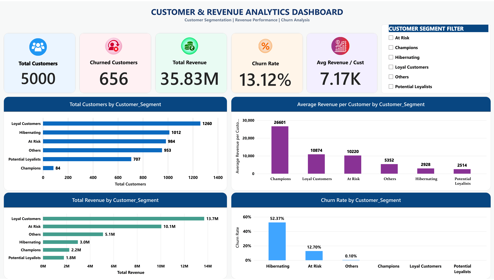

# Customer & Revenue Analytics Dashboard

An end-to-end data analytics project focused on customer segmentation, revenue performance and churn analysis using Python, Jupyter Notebook and Microsoft Power BI.

## Dashboard Preview



**Dashboard files:**
- [View Dashboard PDF](reports/Finance_Dashboard.pdf)
- [Download Power BI Dashboard](powerbi/Finance_Dashboard.pbix)

To interact with the dashboard, download the PBIX file and open it using Power BI Desktop.

## Project Overview

The objective of this project is to analyze customer purchasing behaviour, identify valuable customer segments, understand revenue contribution and examine customer churn patterns.

The analysis uses customer and transaction data from a simulated subscription-based business.

## Business Objectives

- Understand customer purchasing behaviour using RFM analysis.
- Identify high-value and inactive customer segments.
- Analyze revenue contribution by customer segment.
- Identify customer segments with high churn rates.
- Present actionable business insights through an interactive Power BI dashboard.

## Tools & Technologies

- Python
- Pandas
- NumPy
- Matplotlib
- Seaborn
- Jupyter Notebook
- Microsoft Power BI
- DAX

## Dataset Overview

| Dataset | Records |
|---|---:|
| Customer data | 5,000 |
| Transaction data | 135,218 |
| Monthly revenue data | 60 |

**Data note:** The dataset represents a simulated subscription-based business. The original source and redistribution licence should be verified before redistributing the raw data. Currency units are undocumented, so revenue is reported in unspecified revenue units.

## Analysis Workflow

1. Data loading and exploration
2. Data cleaning and validation
3. Exploratory Data Analysis (EDA)
4. RFM analysis: Recency, Frequency and Monetary
5. Customer segmentation
6. Churn analysis
7. Revenue contribution analysis
8. Power BI dashboard development

## Key Findings

- Analyzed 5,000 customers and 135,218 transactions.
- Overall customer churn rate: 13.12%.
- Hibernating customers had the highest segment churn rate at 52.37%.
- Loyal Customers generated the highest total revenue, approximately 13.70 million revenue units.
- Champions had the highest average revenue per customer, approximately 26,601 revenue units.
- Hibernating customers represented approximately 80.79% of all churned customers.

## Customer Segments

Customers were classified into six segments using custom RFM scoring rules:

- Champions
- Loyal Customers
- Potential Loyalists
- At Risk
- Hibernating
- Others

## Power BI Dashboard Features

- Total Customers
- Churned Customers
- Total Revenue
- Churn Rate
- Average Revenue per Customer
- Customer distribution by segment
- Churn rate by segment
- Revenue contribution by segment
- Average revenue per customer by segment
- Interactive customer segment slicer

## Business Recommendations

- Test win-back campaigns for Hibernating customers.
- Focus retention efforts on valuable At Risk customers.
- Maintain personalized engagement with Champions.
- Improve loyalty initiatives for Loyal Customers.
- Monitor customer activity and revenue trends regularly.

These recommendations are hypotheses based on observed patterns and should be tested before implementation.

## Project Limitations

- This analysis is descriptive, not a predictive churn model.
- RFM segment definitions use custom rules for this project.
- The dataset is simulated and does not establish actual banking or company performance.
- Recommendations are not proven business outcomes.

## Repository Structure

```text
Customer-Revenue-Analytics/
│
├── images/
│   └── Finance_Dashboard-1.png
│
├── notebooks/
│   └── 01_data_understanding.ipynb
│
├── powerbi/
│   └── Finance_Dashboard.pbix
│
├── reports/
│   └── Finance_Dashboard.pdf
│
├── README.md
└── LICENSE
```

## How to View the Project

1. Explore the Python notebook in the `notebooks` folder.
2. View the static dashboard in the PDF report.
3. Download the `.pbix` file and open it in Power BI Desktop to interact with the dashboard.

## Author

**Nagendra Dubey**

[GitHub](https://github.com/Dubey125) · [LinkedIn](https://www.linkedin.com/in/nagendra-dubey/)
